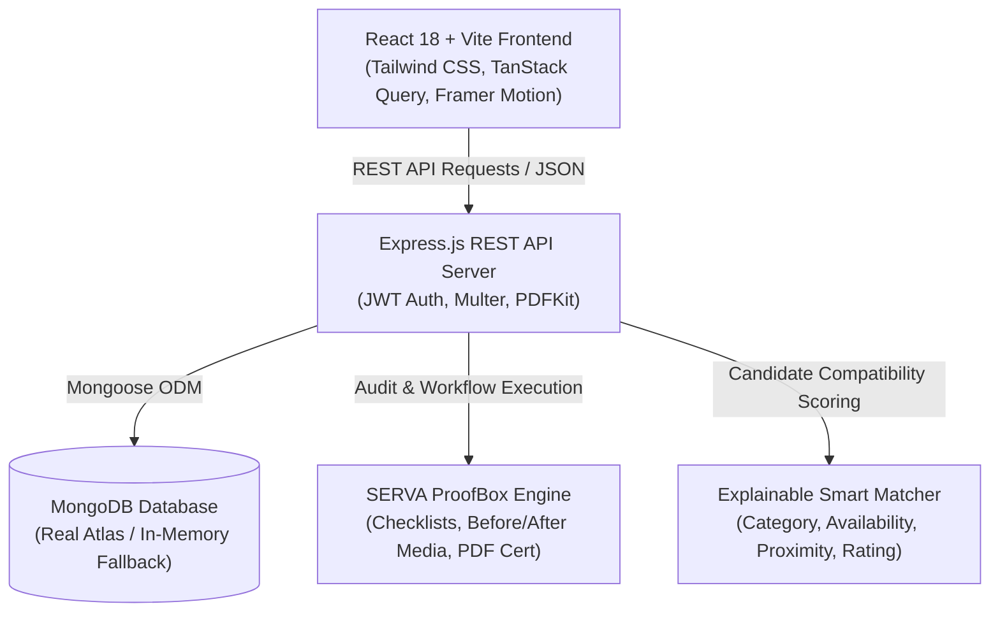
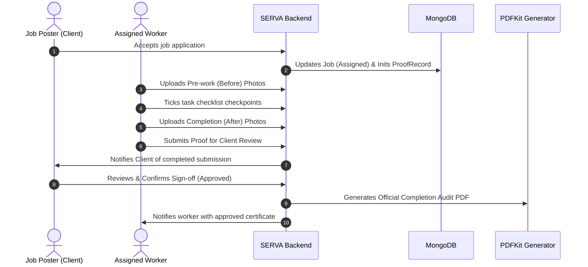

# SERVA — Architecture Documentation

## 1. System Overview

**SERVA** is a modern MERN-stack platform designed specifically for local micro-work, skilled trade services, second-hand marketplace, and community free giveaways in Bangladesh. Its defining differentiator is the **SERVA ProofBox™** audit and trust workflow.

---

## 2. Layered Architecture

### A. Frontend Layer (`client/`)
- **Single Page Application (SPA):** Built with React 18 and Vite for instant HMR and rapid rendering.
- **Routing Engine:** Centralized in `client/src/App.jsx` using React Router DOM v6 with route protection and nested layouts.
- **State Management & Caching:** TanStack React Query v5 for server state caching; React Context API for authentication and session persistence.
- **Design System:** Custom Tailwind CSS configuration built around SERVA's brand palette (Deep Teal `#0F766E`, Dark Teal `#134E4A`, Lime Accent `#C7F36B`, Neutral `#F7F9F8`).

### B. Backend Layer (`server/`)
- **API Runtime:** Node.js v20+ with ECMAScript Modules (`"type": "module"`).
- **HTTP Routing & Controllers:** Express.js REST architecture separated into modular controllers, routes, models, and middleware.
- **Security & Authorization:**
  - JWT sessions in HttpOnly, SameSite cookies; credentialed requests are restricted to configured client origins.
  - Passwords salted and hashed with `bcryptjs` (cost factor 10).
  - Role-based access control (`user` vs `admin`).
  - Ownership validation on all resource updates and deletes (preventing IDOR vulnerabilities).

### C. Database Layer
- **Mongoose ODM:** Strongly typed schemas with indexes for high-frequency queries (category, location, status).
- **Development Database Fallback:** `mongodb-memory-server` may be used locally when no external MongoDB URI is configured. Production requires a reachable persistent MongoDB URI and never falls back to ephemeral storage.

---

## 3. Signature Feature Architecture: SERVA ProofBox™

