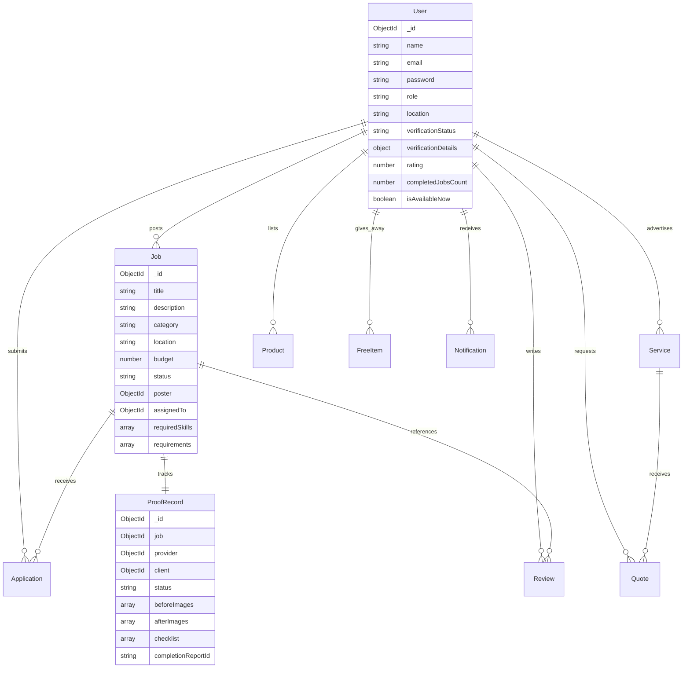

# SERVA — Database Schema & Data Models

## 1. Entity Relationship Model

---

## 2. Core Collections

### 1. `users`
- Stores member profiles, contact info, hashed passwords, trade skills, and availability schedules.
- `verificationDetails.documentPath` and `nidNumber` are kept in private storage and strictly excluded from public user endpoints.

### 2. `jobs`
- Represents local micro-work postings with location, budget, payment type, worker count, urgency, and checklist requirements.
- Indexed by `category`, `location`, `status`, and text search over `title` and `description`.

### 3. `applications`
- Ties an applicant to a job post with introduction, proposed rate, and experience.
- Protected by a compound unique index `{ job: 1, applicant: 1 }` preventing duplicate submissions.

### 4. `proofrecords` (ProofBox)
- The core evidence vault for assigned jobs.
- Contains pre-work (`beforeImages`) and completion (`afterImages`) media, milestone checklists with user and timestamp tracking, and client approval history.
- Produces unique report ID `SRV-PB-XXXXXX` and downloadable PDF completion certificate.

### 5. `services` & `quotes`
- Skilled provider listings with tiered service packages (Basic, Standard, Premium).
- Direct quotation request and response loop.

### 6. `products` & `freeitems`
- Local second-hand community marketplace (Available -> Reserved -> Sold).
- 0 BDT Free Stuff giveaway exchange (Available -> Reserved -> Collected).

### 7. `auditlogs`
- Immutable records for key administrative, verification, and critical status updates.
